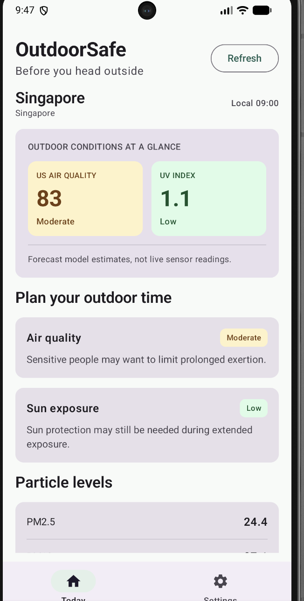
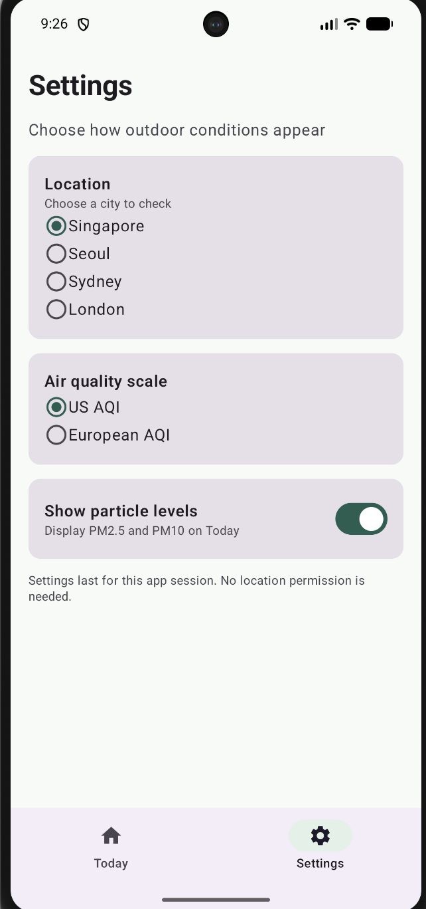
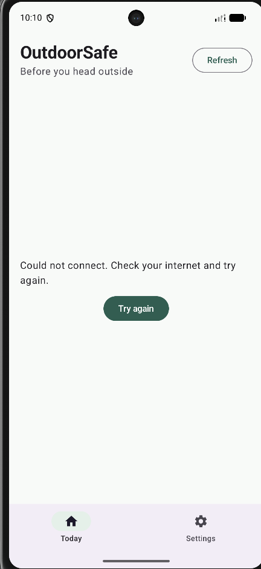

# OutdoorSafe – Daily Outdoor Conditions

OutdoorSafe is a small Android utility app that helps users **check air quality and UV exposure before going outside**. It is designed for everyday decisions such as a walk, commute, or outdoor workout. The main screen shows the most important conditions first, with more details available by scrolling.

This project was developed from the **CP3406 MobileTech Utility App teaching template**. It retains a simple **Today / Settings** layout and adds data from the Open-Meteo Air Quality API.

## Project Motivation

The recent haze in Singapore made the impact of air quality on everyday activities more noticeable. I came across a news report about runners moving their training indoors because of the haze. According to an AFP report published by *The Standard*, more than 80 runners used the corridors of Marina Square shopping mall for a run before the shops opened. The report also described outdoor running sessions being cancelled because of the poor air quality poor air quality [[1]](https://www.thestandard.com.hk/sports-updates/article/346786/Haze-drives-Singapore-runners-from-the-streets-to-shopping-malls).

This is a practical example of why checking outdoor conditions can matter, especially for people planning a walk, commute or run. OutdoorSafe focuses on two pieces of information that are useful to check quickly before heading out: **air quality (AQI)** and **UV exposure**. The aim is not to predict whether an activity is completely safe, but to make relevant forecast information easier to understand at a glance.

## Screenshots

| Today | Settings |
| :--: | :--: |
|  |  |

**Offline error handling:**



Screenshots were captured on a Pixel 7 Android emulator on 29 October 2026. The reported AQI and UV values change with location and forecast time.

## Features

### Today

- A summary of the selected city's **US AQI or European AQI** and **UV index**.
- Separate colour-coded condition cards, with written category labels so that colour is not the only indication of status.
- Short air-quality and sun-exposure guidance based on the displayed category.
- Optional **PM2.5 and PM10** concentrations in µg/m³.
- A list of upcoming hourly AQI and UV estimates.
- **Refresh** to request updated data; loading, error and retry states if a request fails.

### Settings

- Select **Singapore, Seoul, Sydney or London**.
- Switch between **US AQI** and **European AQI**, which use different index scales.
- Show or hide particulate information on the Today screen.
- Changes affect Today immediately. As permitted by the A1 brief, settings are kept only for the current app session.

The app does **not** request GPS location, account sign-in, or personal information. The user selects a city manually.

## How to run

1. Clone or download this repository and open its root folder in **Android Studio**.
2. Allow Gradle Sync to complete.
3. Select an emulator (tested with **Pixel 7, API 37**) and run the `app` configuration.
4. Ensure the emulator has internet access to load the Open-Meteo forecast.
5. Open **Settings** to change the city, AQI scale, or particle visibility. Return to **Today** to check the updated display.

Run local unit tests from the project root:

```bash
bash gradlew :app:testDebugUnitTest
```

On macOS, `bash gradlew ...` works even if the Gradle wrapper does not yet have executable permission.

## Technical design

The app uses **Kotlin, Jetpack Compose, Material 3, StateFlow, coroutines, Retrofit and Gson**. The implementation separates remote data, state handling and interface rendering.

| File | Main responsibility |
| --- | --- |
| `MainActivity.kt` | App entry point and navigation between Today and Settings |
| `OutdoorViewModel.kt` | UI state, current settings, refreshing data and network error handling |
| `data/AirQualityApi.kt` | Retrofit API definition and response data types |
| `data/OutdoorRepository.kt` | Fetches and validates Open-Meteo values; maps API responses into app models |
| `model/OutdoorModels.kt` | City, settings and forecast models |
| `ui/ConditionsScreen.kt` | Today summary, conditions, guidance and hourly list |
| `ui/SettingsScreen.kt` | City, AQI standard and particle display controls |
| `ui/ConditionsFormat.kt` | AQI/UV categories, labels and value formatting |
| `ui/StatusColors.kt` | Condition-based colours for the light and dark themes |

**Data flow:** Open-Meteo API → Retrofit / Repository → ViewModel (`StateFlow`) → Jetpack Compose screens.

The selected city triggers a new API request; changing the AQI scale or particle visibility updates the existing display state without an unnecessary location fetch.

## Testing

The following tests were **performed on 29 October 2026** using Android Studio and a Pixel 7 emulator.

| Test | Observed result |
| --- | --- |
| Open Today while online | Data displayed for Singapore, including AQI, UV and particle values |
| Change city to Seoul | City, country, local time and condition data changed |
| Change US AQI to European AQI | The displayed scale, value and category changed |
| Hide particle levels | PM2.5/PM10 section was removed from Today |
| Show condition-dependent colours | Singapore US AQI Moderate displayed in yellow and UV Low in green |
| Disable emulator internet and refresh | App showed a connection message and **Try again** instead of crashing |
| Re-enable internet and select Try again | Normal dashboard returned with new values |
| Run local unit tests | `bash gradlew :app:testDebugUnitTest` returned **BUILD SUCCESSFUL** after correcting the repository test structure |

The unit tests cover AQI/UV category boundaries, value formatting, missing/invalid response values and Repository response mapping with a fake API. These are local unit tests; the full Android build was additionally exercised through the working emulator screenshots above.

The test report is generated locally at `app/build/reports/tests/testDebugUnitTest/index.html` when the Gradle task is run. That generated build folder is not committed to Git.

## Design choices and limitations

- **At a glance:** AQI and UV are placed first, followed by short advice and optional details.
- **Clear meaning:** Condition labels accompany colours for accessibility. US AQI and European AQI are not treated as interchangeable numbers.
- **Error states:** No fake zero is shown when data is missing; the screen provides a retry action for network failures.
- **Privacy:** Manual city choice avoids the need for a device location permission.
- **Forecast limitations:** The data comes from atmospheric forecast models, **not live local air-quality sensors**. It may differ from local monitoring stations and should not be treated as a guarantee of safety.
- **Scope:** The app requires internet access and does not have offline caching, push notifications or persistent settings.

## Data sources and attribution

Data from **Open-Meteo Air Quality API**, including model data from the **Copernicus Atmosphere Monitoring Service (CAMS)**. The app also shows attribution at the bottom of Today.

- [Open-Meteo Air Quality API documentation](https://open-meteo.com/en/docs/air-quality-api)
- [Open-Meteo terms](https://open-meteo.com/en/terms)
- CP3406 MobileTech Utility App teaching template (provided by JCU)

### Project motivation reference

[1] Agence France-Presse. (2026, October 28). *Haze drives Singapore runners from the streets to shopping malls*. The Standard. https://www.thestandard.com.hk/sports-updates/article/346786/Haze-drives-Singapore-runners-from-the-streets-to-shopping-malls

## GenAI use and academic integrity

Generative AI was used to assist with the initial app implementation, code structure, UI revisions, debugging, tests and documentation drafts. The project was opened and tested in Android Studio, including checking setting changes, unit tests, and network failure/recovery on an emulator. **The official assessment declaration should be completed separately, following the latest course instructions.**

This repository records the project's development and the actual changes made during testing and refinement.
